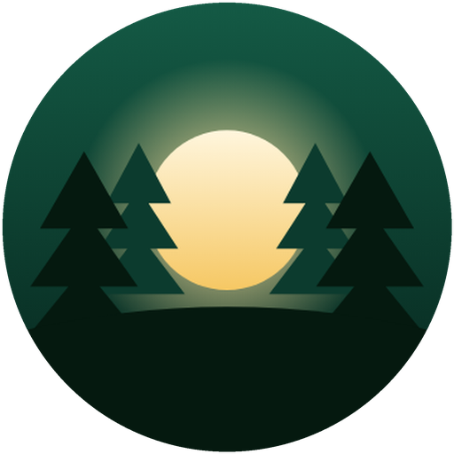

  

<h1 align="center">Clareira</h1>

  App para Android para assistir vídeos sem anúncios, com miniplayer, tela cheia e telinha. 
  <a href="https://github.com/AntonioHKZ/clareira-releases/releases/latest"><b>Baixar a última versão</b></a>

Ele abre como um app comum, em tela cheia, e mantém sua conta conectada. Aqui ficam as versões para baixar.

**Baixe o `Clareira-<versão>.apk` da [última versão](https://github.com/AntonioHKZ/clareira-releases/releases/latest)** (parte Assets da página), direto pelo celular.

## Como instalar

1. Baixe o `Clareira-<versão>.apk` pelo link acima e toque no arquivo (ele fica em **Downloads** ou no app **Meus Arquivos**).
2. **Apareceu "Por segurança, seu telefone não pode instalar apps desconhecidos"?** Toque em **Configurações**, ative **Permitir desta fonte**, volte e toque em **Instalar**.
3. **O Play Protect avisou que o app é desconhecido?** Toque em **Mais detalhes** e depois em **Instalar mesmo assim**. Isso acontece com qualquer app que não vem da Play Store.
4. Na primeira abertura o celular precisa de internet. O app termina de se configurar sozinho e recarrega a página em alguns segundos.
5. **Para atualizar:** baixe o APK da versão nova e instale por cima. Sua conta continua conectada.
6. **Para desinstalar:** segure o ícone do Clareira e toque em **Desinstalar**.

## Encontrou um erro?

Segure o ícone do Clareira e toque em **Relatar erro**. O seu app de e-mail abre com tudo preenchido: é só tocar em **Enviar**. O relatório vai para **clareira.appvid@gmail.com** e traz só informações técnicas do app e do celular, nunca o que você assistiu.

## Sua conta está segura?

Sim. O login é feito **direto na página oficial do Google**, como em qualquer navegador:

- Sua senha vai **direto para o Google**. O Clareira nunca vê nem guarda sua senha.
- **Não temos acesso a nenhum dado da sua conta**: nem e-mail, nem histórico, nem o que você assiste.
- O app **não envia nada para nós**. A única exceção é o **Relatar erro**, que só sai do seu celular se você mesmo tocar em Enviar, e traz apenas informações técnicas do app e do celular.
- Seu login fica salvo só no seu celular, como no navegador.

## Como foi feito

O código do Clareira é privado, mas aqui vai um resumo de como ele funciona por dentro:

- **Kotlin, para Android.** O app é nativo, com a interface própria do player: quadrinho que dá para arrastar, tela cheia ao girar o celular, telinha (Picture-in-Picture) e gestos de arrastar para minimizar e para ver mais vídeos.
- **Motor do Firefox (GeckoView), em vez do WebView do Android.** É o mesmo motor do Firefox para celular, e é ele que permite usar extensões dentro do app.
- **uBlock Origin** para bloquear os anúncios. Ele é instalado e atualizado sozinho, e o app só abre a primeira página depois que o bloqueador está pronto.
- **Uma extensão própria** para os detalhes da interface: conversa entre o app e a página, gestos e esconder ofertas pagas.

Alguns desafios do caminho:

- **Fazer o vídeo começar sozinho**, sem anúncio e rápido, ao tocar num vídeo.
- **Gastar menos bateria e esquentar menos:** o app pede vídeos num formato que o chip do celular decodifica com economia e limita a qualidade ao tamanho da tela.
- **Quando o Android fecha partes do app para liberar memória**, o vídeo volta sozinho do ponto em que estava.
- **Privacidade desde o começo:** o app não tem servidor, não coleta nada, e o relatório de erro nunca registra endereços, buscas ou títulos de vídeos.

Funciona no Android 8 ou mais novo, em celulares de 64 bits (praticamente todos dos últimos anos).

> Projeto pessoal e independente, sem relação com o YouTube, o Google ou a Mozilla.
